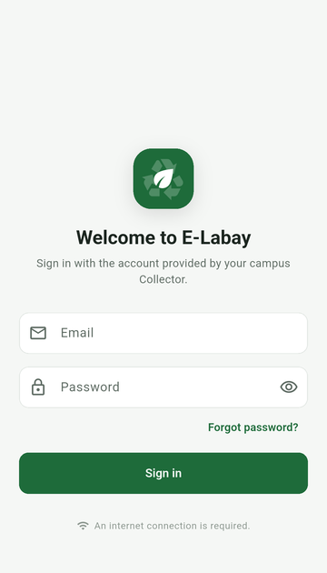
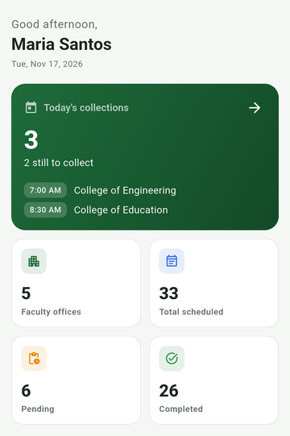

# E-Labay

**Online campus waste management and collection tracking.** E-Labay is a Flutter + Firebase mobile app for faculty offices on a school campus. A **Collector** manually schedules garbage collections, assesses each office's waste segregation at pickup, and awards points. **Faculty Offices** receive real-time schedules and notifications, track their points and performance, and compete on a campus-wide leaderboard.

It runs on Firebase's free **Spark** plan. Upgrading to **Blaze** later adds push notifications, automatic reminders and photos without code changes.

<p align="center">
  
  &nbsp;&nbsp;
  
</p>

| Layer | Technology |
|---|---|
| Mobile app | Flutter 3.47 · Dart 3.13 · Riverpod 3 · GoRouter 18 · fl_chart |
| Authentication | Firebase Authentication (email/password) |
| Database | Cloud Firestore (real-time listeners, transactions, server timestamps, composite indexes) |
| Trusted backend | Firestore security rules that verify every write, including the points |
| Optional (Blaze) | Cloud Functions (FCM push, scheduled reminders) · Cloud Storage (photos) |

## Contents

- [Features](#features)
- [Spark and Blaze plans](#spark-and-blaze-plans)
- [How it works](#how-it-works)
- [Architecture](#architecture)
- [Run it locally](#run-it-locally)
- [Deploy to your Firebase project](#deploy-to-your-firebase-project)
- [Testing](#testing)
- [Configuration](#configuration)
- [Troubleshooting](#troubleshooting)
- [Design notes](#design-notes)

---

## Features

E-Labay has two roles. Each user sees only their role's screens and bottom navigation.

### Collector

| Screen | What it does |
|---|---|
| Dashboard | Today's collections, faculty offices, total/pending/completed schedules, 7-day collection chart, status chart, upcoming collections, recent activity |
| Faculty offices | Search, filter by building, sort by points or segregation rate |
| Office details | Points, rank, performance charts, login accounts (create, deactivate), collection history |
| Add / edit office | Registers an office **and its login account** in one step |
| Schedules | Upcoming, by date or past; filter by office and status |
| Create / edit schedule | Office, date, time and optional instructions. Schedules are always created manually |
| Collection details | Start the collection, reschedule (with reason), cancel (with reason) |
| Assessment | Biodegradable, non-biodegradable, recyclable and residual waste, each marked *Proper*, *Improper* or *N/A*; remarks; live score; review before submitting. Up to 3 evidence photos on Blaze |
| Submission confirmation | Points awarded and the per-category result |
| Collection history | Completed and cancelled collections; filter by office, date range and status |
| Assessment details | Results, points, remarks, photos and the Collector responsible |
| Profile / Settings | Name, password, scoring rules (profile photo on Blaze) |

### Faculty Office

| Screen | What it does |
|---|---|
| Dashboard | Office points, leaderboard rank, latest points, next collection, segregation performance, recent collections |
| Notifications | Real-time feed with unread badge, unread filter and "mark all read"; an in-app banner when a new one arrives |
| Notification details | Full message; opening it marks it read; links to the schedule or assessment |
| Collection schedule | The office's own upcoming and past collections (view only) |
| Collection / assessment details | Instructions, status updates, results and points |
| Leaderboard | Top-three podium, full ranking, own office highlighted |
| Points history | Every point transaction with date, Collector and remarks |
| Performance | Completed collections, total points, average score, proper segregation rate, trend and per-category charts |
| Profile / Settings | Name, password; push notification toggle (used on Blaze) |

There is no point redemption and no automatic or recurring scheduling.

## Spark and Blaze plans

| | Spark (free, default) | Blaze (pay as you go) |
|---|---|---|
| Accounts, schedules, assessments, points, leaderboard | ✅ | ✅ |
| Real-time in-app notification feed and banners | ✅ | ✅ |
| Push notifications when the app is closed | — | ✅ `onNotificationCreated` function |
| Collection reminders (24 hours before) | When the Collector opens the app | Also every 30 minutes on the server |
| Evidence photos and profile pictures | Hidden | ✅ Cloud Storage |

To upgrade: switch the project to Blaze, enable Storage, run `npm run deploy:blaze`, and build the app with `--dart-define=ENABLE_PHOTO_UPLOADS=true`.

## How it works

1. **Login.** Firebase Auth signs the user in. The app reads the role from the user's profile and opens the Collector or Faculty dashboard.
2. **Schedule.** The Collector picks an office, date and time, adds optional instructions, and saves. The schedule and the office's notification are written together.
3. **Notify.** The office sees the notification instantly in its feed (and as a push on Blaze). Within 24 hours of the pickup, the office gets a reminder and the schedule shows *Upcoming*.
4. **Collect.** At the office, the Collector opens the schedule and taps *Start collection & assess* (*In Progress*).
5. **Assess.** The Collector rates the four waste categories and adds remarks.
6. **Score.** The app shows the points; the Collector reviews and submits.
7. **Record.** One Firestore transaction saves the collection, the point transaction, the new office totals, the completed schedule and the office's notifications. The security rules recalculate the score and check every figure before accepting it. The leaderboard re-ranks immediately.
8. **Result.** The office is notified of the completed collection and the points earned.
9. **Monitor.** The office follows its points history, performance charts and leaderboard position.

## Architecture

```
Flutter app ── Riverpod providers ── repositories ──┬─ Firestore: real-time reads; Collector writes
                                                    │  (batches / transactions) verified by rules
                                                    ├─ Firebase Auth (secondary app instance for
                                                    │  creating office accounts)
                                                    ├─ FCM token registration (push on Blaze)
                                                    └─ Storage (photos on Blaze)

firestore.rules   the trusted layer: roles from users/{uid}; an assessment is accepted only as one
                  atomic write whose points match config/scoring and whose office totals add up

functions/        optional, Blaze only:
  onNotificationCreated     push each notification to the recipient's devices
  sendCollectionReminders   every 30 min: reminder + "upcoming" for pickups within 24 h
```

### Project structure

```
lib/
  main.dart, app.dart, firebase_options.dart
  core/          constants, theme, utils (scoring, ranking, formatting, validation),
                 services (Firebase, push notifications, emulator mode, feature flags), exceptions
  models/        user, office, schedule, collection, notification, point transaction, scoring config
  repositories/  Firestore, Auth and Storage access, one per area
  providers/     Riverpod state: session/auth, offices, schedules, collections, notifications,
                 leaderboard, points
  features/      authentication, collector, scheduling, assessment, collections, faculty,
                 notifications, leaderboard, points, profile
  shared/        reusable widgets and components (tiles, charts, performance section)
  routes/        app_routes.dart, app_router.dart (role-based redirects, bottom-navigation shells)
integration_test/  end-to-end test of the real repositories against the emulators
test/              Dart unit, widget and screen-render tests
tests/             security-rules tests, demo data seed
functions/         optional Blaze functions, create-collector admin script
firestore.rules · firestore.indexes.json · storage.rules · firebase.json
```

### Data model

| Collection | Written by | Contents |
|---|---|---|
| `users/{uid}` | Collector (Faculty accounts), admin script (Collectors). Users may edit only `fullName`, `profileImage`, `pushEnabled` | `role` (`collector` or `faculty`), `officeId` (null for Collectors), `isActive`. Device tokens in `fcmTokens/{token}` |
| `offices/{officeId}` | Collector: create with zero totals; edit name, building, description. Totals change only with a verified assessment | `totalPoints`, `totalCollections`, `totalProperSegregations`, `totalAssessments`, `categoryStats`, `lastCollectionId`. Also the leaderboard source |
| `schedules/{scheduleId}` | Collector (create, edit, reschedule, cancel, start, remind, complete) | `collectionDate` (date and time), `collectionTime` (`HH:mm`), `status`, `notes`, `statusNote` |
| `collections/{scheduleId}` | Collector, inside the assessment transaction; create-only | `segregationResults`, `pointsAwarded`, `remarks`, `evidenceImageUrls`, Collector. Same id as the schedule, so a collection can be assessed only once |
| `point_transactions/collection_{scheduleId}` | Collector, inside the assessment transaction; create-only | Permanent point ledger. The fixed id prevents double awards |
| `notifications/{id}` | Collector, together with the change it describes; the recipient may only mark it read | `recipientId`, `title`, `message`, `notificationType`, `relatedId`, `isRead`, `createdAt` |
| `config/scoring` | Collector (validated by rules) | `properPoints` (default 10), `improperPoints` (default 0) |

### Points and leaderboard

For each collection, every **properly segregated** category earns 10 points, **improperly segregated** earns 0, and **not applicable** categories are left out. With the defaults a collection is worth at most 40 points. The Collector can change both values in Settings; changes apply to future assessments only.

The security rules recalculate the score from the four results and `config/scoring`. They reject the assessment unless the collection record, the point transaction, the office totals and the per-category counts all match. The leaderboard ranks offices by total points. **Offices with equal points share a rank** (1, 2, 2, 4) and are listed alphabetically.

### Security

- Roles live in `users/{uid}`. Only a Collector can create Faculty Office profiles, and only the admin script can create Collectors. Nobody can change their own role, office or active flag. Accounts that sign up on their own get no profile and can't read anything.
- **Firestore rules** allow only active, signed-in users with a profile. Only Collectors can create or manage schedules, with field validation and allowed status changes. Schedules complete, and points change, only through a verified assessment written in one transaction. Collections and point transactions can't be edited or deleted. Faculty Offices can read only their own schedules, collections, point history and notifications. Active users can read the leaderboard (office totals).
- **Deactivated** accounts (`isActive: false`) are locked out of all data and signed out by the app.
- **Storage rules** (Blaze) let only Collectors upload evidence photos (images under 5 MB). Only Collectors and the office concerned can view them, and they can't be changed afterwards.
- No service-account key is stored in the app or the repository. `firebase_options.dart` and `google-services.json` contain only public client identifiers.

---

## Run it locally

The Firebase Emulator Suite runs Auth, Firestore and Storage on your computer with the real security rules. Nothing touches your live project.

**You need:** Flutter 3.47+, Node.js 22 (20 also works), Java 21 on your `PATH`, and an Android emulator or device.

Install the tooling:

```bash
npm install
```

Start the emulators:

```bash
npm run emulators
```

In a second terminal, load demo data: 5 offices, two weeks of assessed collections and upcoming schedules.

```bash
npm run seed
```

Run the app against the emulators:

```bash
flutter run --dart-define=USE_FIREBASE_EMULATORS=true
```

On a physical phone, also pass `--dart-define=FIREBASE_EMULATOR_HOST=<your computer's LAN IP>`.

**Demo sign-ins** (local emulators only):

| Role | Email | Password |
|---|---|---|
| Collector | `collector@elabay.test` | `collector123` |
| Faculty Office | `eng@elabay.test`, `educ@elabay.test`, `registrar@elabay.test`, `nursing@elabay.test`, `accounting@elabay.test` | `office123` |

The Emulator UI is at http://127.0.0.1:4000. Emulator data is cleared when the emulators stop; run `npm run seed` again after restarting.

## Deploy to your Firebase project

### 1. Create the Firebase project

In the [Firebase Console](https://console.firebase.google.com):

1. Create a project (the free Spark plan is enough).
2. **Authentication → Get started → Sign-in method:** enable **Email/Password**.
3. **Firestore Database → Create database:** production mode, location `asia-southeast1` (it can't be changed later).

### 2. Connect the tooling and the app

```bash
npm install
```

```bash
npx firebase login
```

```bash
npx firebase use --add
```

```bash
dart pub global activate flutterfire_cli
```

```bash
flutterfire configure --platforms=android,ios
```

FlutterFire writes `lib/firebase_options.dart` and `android/app/google-services.json`. Until then, the app opens on a "Firebase setup required" screen.

### 3. Deploy the security rules and indexes

```bash
npm run deploy
```

Indexes take a few minutes to build.

### 4. Create the first Collector

Collector accounts can't be created from the app.

1. In the Firebase Console, open **Authentication → Users → Add user** and create the Collector's email and password.
2. Give that account the Collector role:

```bash
gcloud auth application-default login
```

```bash
npm --prefix functions install
```

```bash
npm --prefix functions run create-collector -- --project YOUR_PROJECT_ID --email collector@school.edu --name "Collector Name"
```

The script creates the Collector's profile and saves the default scoring rules.

### 5. Build and install the app

```bash
flutter build apk --release
```

The APK is in `build/app/outputs/flutter-apk/app-release.apk`. Sign in as the Collector and use **Offices → Add office** to register each faculty office with its login account. Give each office its temporary password privately; they can change it under **Profile**.

### Optional: upgrade to Blaze

1. Switch the project to the Blaze plan and click **Storage → Get started** (`asia-southeast1`).
2. Deploy the functions and Storage rules:

```bash
npm --prefix functions install
```

```bash
npm run deploy:blaze
```

3. Build with photos enabled:

```bash
flutter build apk --release --dart-define=ENABLE_PHOTO_UPLOADS=true
```

For iOS push, also upload an APNs key (*Project settings → Cloud Messaging*). In Xcode, enable **Push Notifications** and **Background Modes → Remote notifications**.

---

## Testing

| Suite | Command | Tests | Covers |
|---|---|---|---|
| Dart unit, widget and screen-render | `flutter test` | 35 | Scoring, leaderboard ties, role redirects, data parsing, shared widgets; main screens rendered on small and large phones |
| Security rules | `npm run test:rules` | 41 | All 10 access rules; account provisioning; the atomic assessment write, including forged points, partial writes and duplicates; notifications; scoring config; Storage |
| End-to-end on a device | `npm run test:app` | 6 | The app's real repositories on an Android emulator against the local Firebase emulators: provisioning, scheduling, assessment and points, duplicate rejection, reminders, reschedule and cancel, Faculty access, deactivation |

The rules and end-to-end tests start the emulators themselves and need Java 21. `test:app` expects an Android emulator running as `emulator-5554`. Run `flutter analyze` for static analysis.

## Configuration

| Setting | Where | Default |
|---|---|---|
| Points per category | App: Collector → Profile → Settings → Scoring rules | 10 proper / 0 improper |
| Photo uploads (Blaze) | `--dart-define=ENABLE_PHOTO_UPLOADS=true` | off |
| Evidence photos per collection | `AppConstants.maxEvidencePhotos` | 3 |
| Local emulator mode | `--dart-define=USE_FIREBASE_EMULATORS=true` (and optionally `FIREBASE_EMULATOR_HOST`) | off |
| Functions region (Blaze) | `REGION` in `functions/src/config.ts` | `asia-southeast1` |
| Time zone in server-sent reminders (Blaze) | `CAMPUS_TIME_ZONE` in `functions/.env` | `Asia/Manila` |

## Troubleshooting

| Problem | Fix |
|---|---|
| App shows "Firebase setup required" | Run `flutterfire configure`, or use the local emulator mode |
| "A required database index is still being built" | Wait a few minutes after `npm run deploy` |
| Signed in, but "No E-Labay profile is linked to this account" | The account has no profile. Create Collectors with `create-collector` and offices from the app |
| "The assessment was rejected" | It was already submitted, or the scoring rules changed meanwhile. Reopen the collection and try again |
| Emulators or Gradle fail with `Unable to establish loopback connection` (Windows) | Set `JAVA_TOOL_OPTIONS=-Djdk.net.unixdomain.tmpdir=C:\Temp` (any short existing folder) and retry |
| Android build fails with `Could not close incremental caches` | Already handled: `kotlin.incremental=false` in `android/gradle.properties` (needed when the project and the Flutter package cache are on different drives) |

## Design notes

- On Spark there is no server code. The trust boundary is the Firestore security rules, which verify each write against the stored data. This includes the score calculation, the office totals and the one-time ledger entry.
- Office accounts are created by the Collector's app through a separate Firebase app instance, so the Collector stays signed in. If saving the profile fails, the new login is deleted again.
- A schedule's office can't be changed. Cancel it and create a new one, so notifications and history stay clear. Changing the date or time always marks a schedule *Rescheduled*.
- Renaming an office doesn't change the name stored on its past schedules and collections.
- Push notifications on Blaze use FCM registration tokens, which the Admin SDK sends to. `firebase_messaging` 17 marks this API as deprecated but still supports it.
